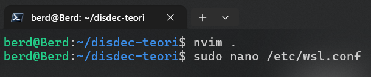
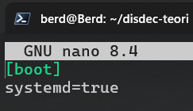
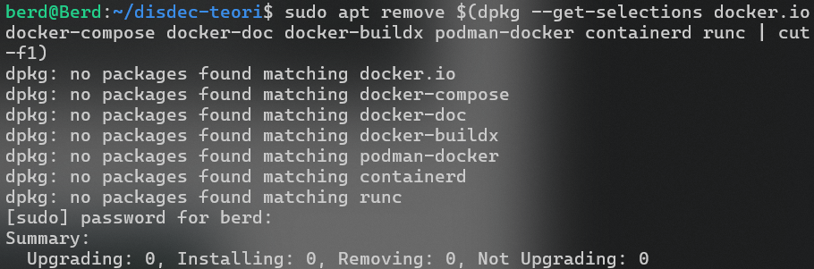
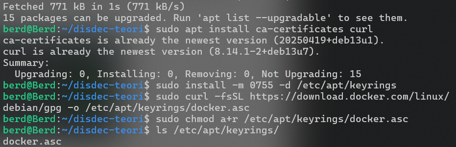
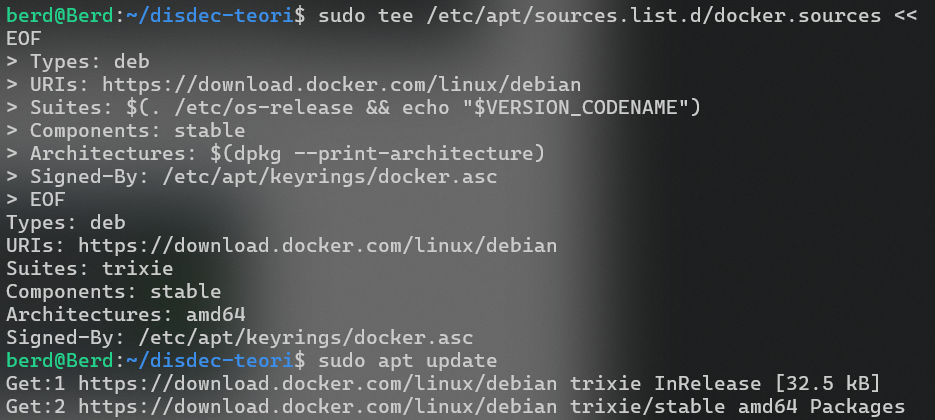
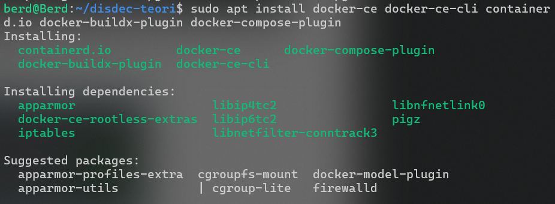
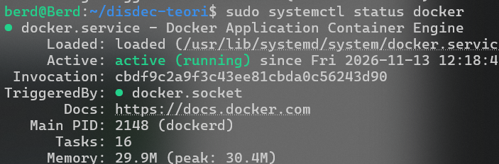
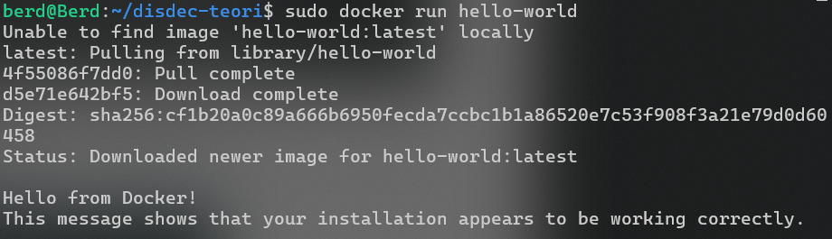

# Rangkuman MATERI-04: Konsistensi dan Replikasi pada Sistem Terdistribusi

## 1. Konsep Dasar Konsistensi

* **Definisi**: Jaminan bahwa semua *node* (server) dalam sistem terdistribusi memiliki salinan data yang sama atau tampak konsisten pada waktu tertentu, meskipun data diubah secara bersamaan di tempat berbeda.

* **Mengapa penting**: Mencegah perbedaan data antar-server (misalnya pada transaksi perbankan, dimana saldo rekeniing di satu server sudah berkurang tapi di server lain belum diperbarui sehingga transaksi gagal).

```
       [ Klien / Pengguna ]
          /           \
         v             v
  +--------------+  +--------------+
  |  Server A    |  |  Server B    |
  |  (Data: x)   |  |  (Data: x)   |
  +--------------+  +--------------+
```

## 2. Teorema CAP (Brewer's Theorem)

Dalam sistem terdistribusi yang mengalami partisi jaringan, sistem tidak dapat mencapai ketiganya secara bersamaan:

1. **Consistency (C)**: Semua *node* melihat data yang sama persis.

2. **Availability (A)**: Setiap permintaan (*request*) selalu mendapat respons non-error.

3. **Partition Tolerance (P)**: Sistem tetap berjalan meskipun ada gangguan/putus komunikasi antar-jaringan.

```
                  .
                 / \
                /   \
               / C-A \
              /  CAP  \
             /_________\
            /           \
           / Consistency \
          /_______________\
         /                 \
        /   Availability    \
       /_____________________\
      /  Partition Tolerance  \
     /_________________________\
```

* *Contoh Trade-off (e-Commerce)*: Jika jaringan antar wilayah terputus, sistem harus memilih antara **AP** (tetap bisa transaksi tapi stok bisa tidak sinkron sementara) atau **CP** (menolak transaksi demi menjaga konsistensi stok).

## 3. Model Konsistensi

Model konsistensi menentukan seberapa cepat perubahan data disebarkan dan terlihat oleh *node* lain:

```
Strong Consistency (Linearizable / Sequential)
         |
         v
  Causal Consistency
         |
         v
  Client-Centric (Read-your-writes, Monotonic read)
         |
         v
  Eventual Consistency (BASE Model) -> Weak Consistency
```

1. **Strong Consistency (Linearizable & Sequential)**: Setiap pembacaan setelah penulisan pasti menghasilkan nilai terbaru yang sama di semua *node* (Contoh: Sistem perbankan, etcd, ZooKeeper).

2. **Eventual Consistency**: Data tidak langsung sama di semua node, namun akan konsisten pada akhirnya jika tidak ada pembaruan lagi (Menerapkan prinsip **BASE**: *Basically Available, Soft-state, Eventual consistency*). Contoh: Amazon DynamoDB, Apache Cassandrai

3. **Causal Consistency**: Operasi yang memiliki hubungan sebab-akibat harus terlihat dalam urutan yang sama oleh semua *node* (Contoh: Komentar media sosial tidak boleh muncul sebelum postingan utamanya).

4. **Read-Your-Writes Consistency**: Pengguna yang menulis data akan langsung melihat hasil tulisannya sendiri pada pembacaan berikutnya.

5. **Monotonic Read Consistency**: Pengguna tidak akan melihat versi data yang lebih lama dari yang sudah pernah ia lihat sebelumnya.

## 4. Trade-Off antara Latensi dan Konsistensi

* **Konsistensi Tinggi (+)** -> **Latensi Tinggi (+)**: Sistem harus menunggu sinkronisasi lintas jaringan selesai sebelum meberikan respons ke pengguna.

* **Konsistensi Lemah (-)** -> **Latensi Rendah (-)**: Sistem langsung merespons dengan cepat, namun ada risiko data belum sinkron secara global untuk sementara waktu.

## 5. Replikasi Data dan Strategi Sinkronisasi

* **Pengertian**: Proses membuat dan memelihara salinan data di beberapa *node* guna meningkatkan ketersediaan (*availiability*), kinerja (*performance*), reliabilitas, dan skalabilitas *read load*.

```
  +--------+          +------------+  +------------+  +------------+
  | Source | --writes->| Replica #1 |  | Replica #2 |  | Replica #N |
  | (Master)|          +------------+  +------------+  +------------+
  +--------+                 ^               ^               ^
       |                     |               |               |
       +---------------------+---------------+---------------+
                                 Replication
```

**Jenis Replikasi**:

* ***Master-Slave (Primary-Secondary)***: Satu *master* menangani tulis/baca, *slave* mereplikasi data (Contoh: PostgreSQL Streaming Replication).

* ***Multi-Master (Peer-to-Peer)***: Semua *node* bisa melakukan operasi tulis dan baca (Contoh: Apache Cassandra, MongoDB, Apache Ignite).

**Waktu Sinkronisasi**:

* ***Synchronous***: Sumber menunggu semua replika melakukan *commit* (konsistensi tertinggi, performa lambat).

* ***Asynchronous***: Sumber langsung *commit* tanpa menunggu replika (performa tercepat, risiko kehilangan data).

* ***Semi-synchronous***: Sumber menunggu minimal satu replika menerima data (jalan tengah, digunakan oleh MySQL).

**Penanganan Konflik**: Menggunakan *Last Write Wins* (LWW), *Vector Clock*, *CDRT* (Conflic-free REplicated Data Types, misal pada Yjs untuk *collaborative editor*), atau *Operational Transformation* (OT).

## 6. Protokol Replikasi

1. **Quorum-based**: Operasi tulis/baca dianggap berhasil jika dikonfirmasi oleh sejumlah *node* tertentu. Syarat: ***W + R > N*** (dimana ***W*** adalah kuorum tulis, ***R*** adalah kuorum baca, dan ***N*** adalah total *node*).

2. **State Machine Replication**: Perintah dieksekusi oleh semua replika dalam urutan log yang sama persis melalui *leader*.

3. **Gossip Protocol**: *Node* secara periodik bertukar status secara acak dengan *peer* lain untuk menyebarkan pembaruan dengan cepat dalam *cluster* (digunakan di Apache Cassandra).

4. **Chain Replication**: Klien menulis ke *head* dari rantai *node*, data diteruskan berurutan hingga *tail* tempat pembacaan dilakukan (digunakan di Azure Storage).

## 7. Studi Kasus

### 1. Streaming Replication di PostgreSQL 18

#### a. Install Docker dan Docker-Compose di WSL-Debian

> notes penulis menganut sumber *https://docs.docker.com/engine/install/debian/*

**Cek systemd**

```bash
$ sudo nano /etc/wsl.conf
```





**Bersihkan Docker Untuk Install Ulang**

```bash
$ sudo apt remove $(dpkg --get-selections docker.io docker-compose docker-doc docker-buildx podman-docker containerd runc | cut -f1)
```



**Buat dan Cek Sertifikat**

```bash
$ sudo apt update
$ sudo apt install ca-certificates curl
$ sudo install -m 0755 -d /etc/apt/keyrings
$ sudo curl -fsSL https://download.docker.com/linux/debian/gpg -o /etc/apt/keyrings/docker.asc
$ sudo chmod a+r /etc/apt/keyrings/docker.asc
$ ls /etc/apt/keyrings/
```



**Menyiapkan Target Sumber**

```bash
$ sudo tee /etc/apt/sources.list.d/docker.sources <<EOF
> Types: deb
> URIs: https://download.docker.com/linux/debian
> Suites: $(. /etc/os-release && echo "$VERSION_CODENAME")
> Components: stable
> Architectures: $(dpkg --print-architecture)
> Signed-By: /etc/apt/keyrings/docker.asc
> EOF
```



**Menginstal Docker dan Docker-Compose**

```bash
$ sudo apt update
$ sudo apt install docker-ce docker-ce-cli containerd.io docker-buildx-plugin docker-compose-plugin
```



**Mengaktifkan Docker**

```bash
$ sudo systemctl status docker
```



**Test Docker**

```bash
$ sudo docker run hello-world
```



#### c. PostgreSQL 18

#### d. Streaming Replication

### 2. Apache Ignite 3 Master-Master

#### a. Docker Compose

#### b. Apache Ignite 3

#### c. SQL


## 8. Jawaban Pertanyaan Diskusi

### 1. Apa kelebihan dan kekurangan strong vs eventual consistency?

* **Strong Consistency**

    * *Kelebihan*: Menjamin data selalu akurat, seragam, dan valid di semua *node* tanpa risiko membaca data kedaluwarsa (*stale data*); sangat krusial untuk aplikasi finansial/perbankan.

    * *Kekurangan*: Menimbulkan latensi tinggi karena sistem harus menunggu proses sinkronisasi lintas jaringan selesai sebelum merespons pengguna.

* **Eventual Consistency**

    * *Kelebihan*: Memberikan performa yang sangat cepat dan ketersediaan tinggi (*high availability*) karena respons diberikan secara instan tanpa menunggu seluruh replika selesai diperbarui.

    * *Kekurangan*: Memiliki risiko inkonsistensi data sementara (*data delay*), di mana pengguna mungkin membaca data lama jika mengakses *node* yang belum tersinkronisasi.


### 2. Bagaimana jika replikasi gagal di suatu node?

* **Dampak**: Bergantung pada strategi konsistensi yang dipakai:

    * Jika menggunakan **Synchronous Replication**, kegagalan pada suatu *node* akan menahan seluruh proses *commit* transaksi atau menyebabkan operasi tulis di tolak demi menjaga konsistensi mutlak.

    * Jika menggunakan **Asynchronous / Quorum-based Replication**, sistem tetap dapat berjalan normal dan melayani *request* selama kuorum minimal (**W** dan **R**) terpenuhi oleh *node-node* lain yang sehat. *Node* yang gagal akann melakukan sinkronnisasi ylang (*catch up*) menggunakan file log (seperti WAL di PostgreSQL) setelah kontainer atau jaringan pulih.
