# Rangkuman MATERI-05: Fault Tolerance

## 1. Pengertian

* **Fault Tolerance**: Kemampuan sistem yang mempertahankan operasional dengan tepat meski terjadi kegagalan (*failure*) atau kesalahan pada satu atau beberapa komponennya. Ini sangat vital untuk sistem *high availability, mission-critical,* dan *life-critical*.

* **Urgensi**: Sistem terdistribusi dan terdesentralisasi memiliki banyak komponen dan jalur komunikasi kompleks. Semakin krusial suatu aplikasi, semakin tinggi pula tuntutan ketersediaannya (*high availability*).

## 2. Klasifikasi Kegagalan (Faults)

**Jenis berdasarkan sifat**:

* *Transient Fault*: Bersifat sementara (contoh: gangguan akibat sambaran petir).

* *Intermittent Fault*: Muncul dan hilang berulang kali (contoh: *overheating* perangkat keras).

* *Permanent Fault*: Bersifat tetap/rusak total.

* *Byzantine Fault*: Komponen gagal dan memberikan respons acak atau tidak konsisten kepada komponen lain.

**Jenis berdasarkan sumber**:

* *Hardware Faults* (kerusakan disk, kegagalan daya).

* *Software Faults* (bug, memory leak, race condition).

* *Communication Faults* (packet loss, network partition).

## 3. Teknik Desain untuk Mencapai Fault Tolerance

1. **Redundancy & Replication**: Menyediakan cadangan sumber daya dan mereplikasi data ke berbagai *node* untuk menghilangkan *single point of failure*.

2. **Load Balancing**: Melakukan *scaling* aplikasi menjadi beberapa instans dan mendistribusikan lalu lintas menggunakan *load balancer* (seperti Nginx atau HAProxy).

3. **Checkpointing & Rollback Recovery**: Menyimpan status sistem secara berkala (*checkpoint*) agar ketika terjadi kegagalan, sistem dapat langsung dipulihkan dari titik terakhir tanpa harus mengulang dari awal.

4. **Heartbeat & Failure Detection**: Mengirimkan sinyal periodik antar-komponen. Jika sinyal tidak diterima dalam batas waktu tertentu, komponen tersebut dianggap gagal (*down*).

5. **Circuit Breaker Pattern**: Mencegah kegagalan berantai pada arsitektur *microservices* dengan memblokir sementara panggilan ke layanan yang gagal (memiliki status *Closed*, *Open*, dan *Half-Open*).

6. **Consensus & Coordination**: Proses agar beberapa *node* mencapai kesepakatan (*consensus*) terhadap suatu status atau urutan operasi (misalnya menggunakan algoritma Raft atau teknologi Blockchain).

7. Actor Model: Isolasi proses mandiri yang berkomunikasi melalui pesan (*mailbox*) dan dikelola oleh sistem pengawas (supervisor-worker tree) untuk melakukan restart otomatis jika terjadi crash.

## 4. Praktik Lecture Notes

Prakitk ini menskalakan aplikasi web kerangka kerja Python (BlackSheep) menjadi dua instans di dalam kontainer Docker, lalu membagikan bebannya menggunakan Nginx sebagai *reverse proxy load balancer*.

### Persiapan Workspace & Virtual Environment

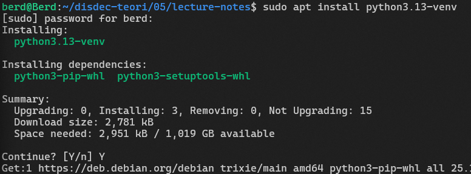

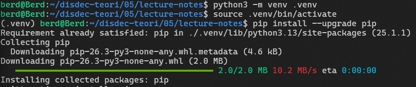

### Menginstall BlackSheep

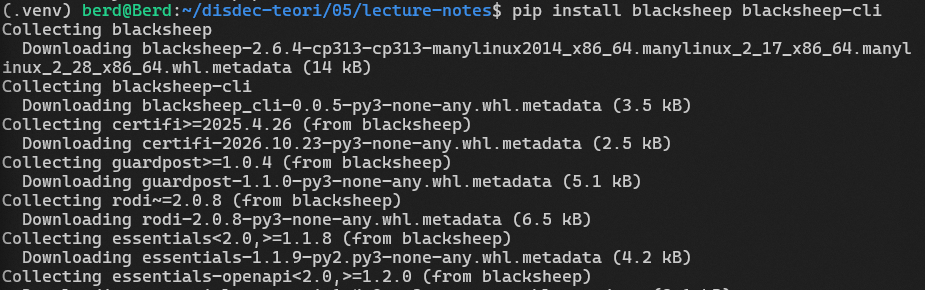

### Membuat Projek BlackSheep

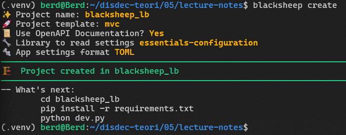

### Menjalankan BlackSheep

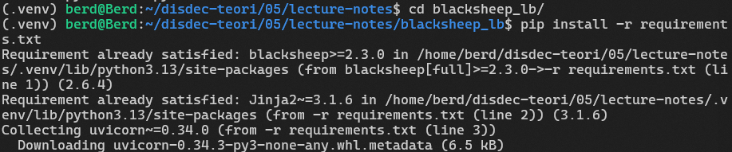

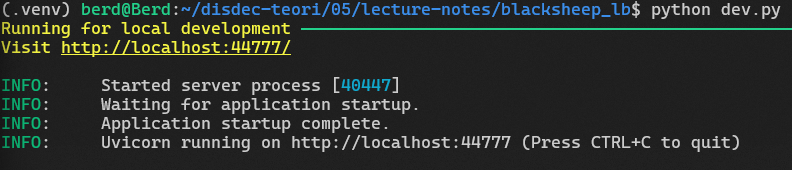

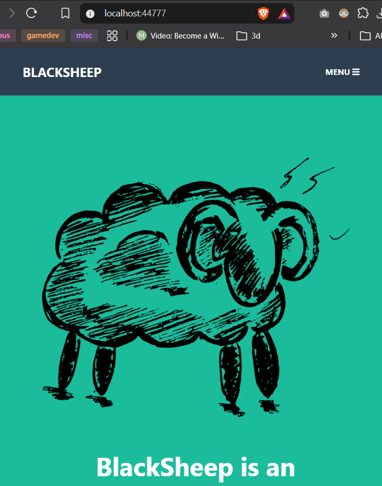

### Menyiapkan Projek Nginx dan Compose

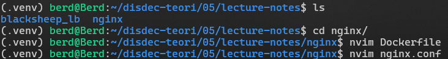

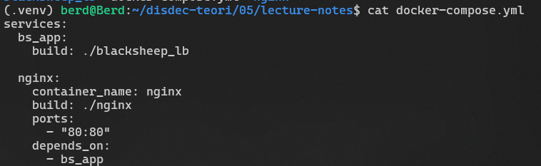

### Menjalankan Scaling

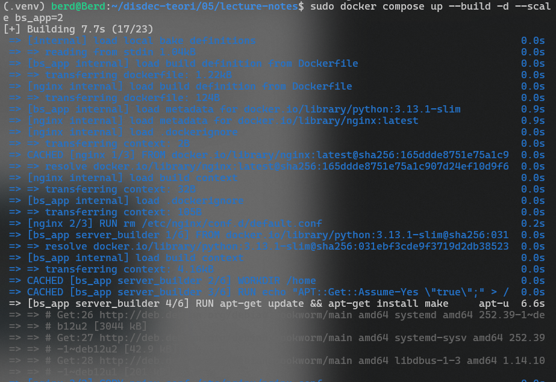

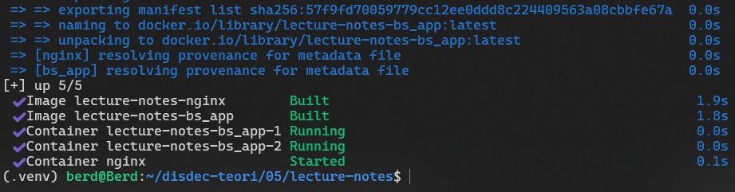

### Verifikasi Load Balancing

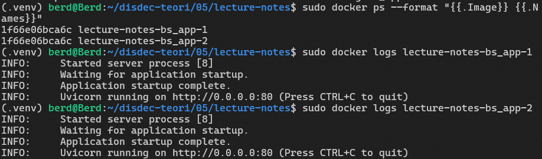

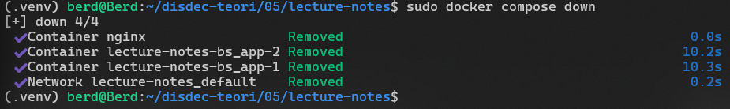

